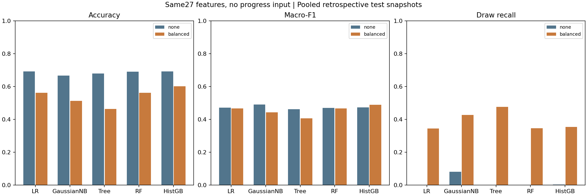

# Progressive Chess Outcome Prediction — progress-free baselines

当前主线对齐[feature分支](https://github.com/processor-zhong/Chess/tree/feature)的棋局特征与回顾性评估设计（来源提交`5f86a39`），**修复真实progress作为模型输入造成的未来信息泄漏**。
统一使用**10列赛前＋17列局面特征**，比较传统模型的**不加权与balanced**两种设置。原20半回合实验独立保留。

## 本轮做了什么

- 采用feature分支的去重、按对局分层70/15/15划分和10%／25%／50%／75%／100%棋谱采样。
- 删除模型输入中的`progress`和`actual_progress`；所有分类器直接使用相同27列，不做概率融合。
- LR、GaussianNB、决策树、RF、HistGB各拟合none与balanced版本，另加经验多数类基线，共11个模型。
- 旧实验的固定参数配方迁移到新特征，本轮未重新调参。完整报告所有设置，不按测试结果只选好看的版本。

训练13,379盘／66,346局面，验证2,867盘／14,200局面，测试2,867盘／14,179局面；同盘棋不跨分区。
**以下是包含最后记录局面的多时点测试汇总，不是固定前10步的准确率。历史测试已被探索，本轮不是新盲测。**

## 不加权（none）

| 模型 | Accuracy | Macro-F1 | 和棋Precision | 和棋Recall | 和棋F1 | Log Loss ↓ |
|---|---:|---:|---:|---:|---:|---:|
| 多数类基线 | 49.86% | 0.2218 | 0.00% | 0.00% | 0.0000 | 0.8486 |
| 逻辑回归 | 69.23% | 0.4716 | 0.00% | 0.00% | 0.0000 | 0.6814 |
| 高斯朴素贝叶斯 | 66.75% | 0.4913 | 9.64% | 7.99% | 0.0874 | 1.3270 |
| 决策树 | 67.90% | 0.4620 | 0.00% | 0.00% | 0.0000 | 0.7308 |
| 随机森林 | 69.06% | 0.4703 | 0.00% | 0.00% | 0.0000 | 0.6841 |
| HistGB | 69.23% | 0.4737 | 13.33% | 0.30% | 0.0059 | 0.6764 |

## 类别平衡（balanced）

| 模型 | Accuracy | Macro-F1 | 和棋Precision | 和棋Recall | 和棋F1 | Log Loss ↓ |
|---|---:|---:|---:|---:|---:|---:|
| 逻辑回归 | 56.21% | 0.4661 | 5.89% | 34.39% | 0.1005 | 0.9170 |
| 高斯朴素贝叶斯 | 51.28% | 0.4426 | 5.78% | 42.68% | 0.1019 | 1.6227 |
| 决策树 | 46.39% | 0.4058 | 5.34% | 47.66% | 0.0960 | 0.9733 |
| 随机森林 | 56.25% | 0.4675 | 5.82% | 34.54% | 0.0996 | 0.8959 |
| HistGB | 60.13% | 0.4886 | 8.52% | 35.44% | 0.1374 | 0.8675 |

balanced权重仅按训练标签计算：`N_train / (3 × n_class_train)`。GaussianNB通过训练`sample_weight`实现，其余学习器使用`class_weight`。
Dummy是经验类别先验参照，balanced不适用，因此只列在不加权表。

不加权LR与HistGB的Accuracy并列最高；本轮Macro-F1最高为不加权GaussianNB，但其Log Loss较差。
balanced HistGB的和棋F1最高；和棋精确率仍低，不能只凭召回率判断模型可靠。



## 详细结果与运行入口

- [完整结果：全部模型、两种权重、分时点成绩及文件索引](modelling_baselines/run_20261026_feature_01/RESULTS_ZH.md)
- [完整数值CSV：验证／测试、汇总／每个时点](modelling_baselines/run_20261026_feature_01/tables/metrics.csv)
- [各类别Precision／Recall／F1](modelling_baselines/run_20261026_feature_01/tables/per_class.csv)
- [完整参数](modelling_baselines/run_20261026_feature_01/artifacts/fitted_parameters.json)和[训练类别权重](modelling_baselines/run_20261026_feature_01/artifacts/train_class_weights.json)
- [方法、特征与progress修复范围](docs/PROGRESSIVE_BASELINES_ZH.md)
- [Progressive_Baselines.ipynb](Progressive_Baselines.ipynb)：已执行的结果查看器，Run All不训练。

逐局面概率、三分类混淆矩阵和模型文件位于[本轮目录](modelling_baselines/run_20261026_feature_01)。

## progress修复的范围

原feature模型使用`当前步数 / 最终总步数`作为预测变量，真实预测时分母未知。
新特征函数不接受progress参数，27列输入契约排除进度、ID、目标及采样元数据；模型重载和未来字段扰动检查均已覆盖。
**百分比采样仍依赖最终棋谱长度，100%包含最后局面**，因此保留回顾性研究定位；固定开局能力须另外使用固定ply评估。

## 环境与验证

推荐Python3.12，依赖固定在requirements.txt；查看Notebook安装requirements-notebook.txt。无需PyTorch。

```bash
python -m pip install -r requirements-notebook.txt
python verify_snapshot.py
python verify_progressive_baselines.py --reload-models
python -m unittest discover -s tests -p "test_progressive*.py" -v
# 新输出目录，避免覆盖保存结果：
python run_progressive_baselines.py --output modelling_baselines/local_progressive_reproduce
```

## 历史实验

原RF、旧6／46列模型比较及其时间划分保持独立，不能与上述新特征成绩混成同一次实验。
旧入口：[Baseline_Model_Comparison.ipynb](Baseline_Model_Comparison.ipynb)、[旧提交说明](docs/SUBMISSION_20PLY_ZH.md)。

<details>
<summary>展开原20半回合交接说明（历史版本）</summary>

# Chess outcome prediction after 10 full moves

CA6001 group handover: **Outcome prediction after 10 full moves (20 plies)**.

使用双方各前10步结束时的信息，预测 **Black win / Draw / White win**。保留“赛前6列”与“赛前＋开局46列”的特征实验。**此仓库不包含Stockfish扩展或旧10半回合实验。**

## 本次提交：基础模型比较与调参

多数类基线、逻辑回归、高斯朴素贝叶斯、单棵决策树、随机森林、直方图梯度提升。
对比赛前6列和赛前＋开局46列；训练内三折时间CV选参，固定验证集评价。
本次主线不包含神经网络。初始配置是仓库starter设置，不全部等同于sklearn默认参数。

1. [提交说明与报告摘要](docs/SUBMISSION_ZH.md)：范围、结果、RF来源和文件清单。
2. [Baseline_Model_Comparison.ipynb](Baseline_Model_Comparison.ipynb)：已执行的比较、调参、三分类混淆矩阵和ROC。
3. [统一比较表与图](modelling_baselines/comparison_20ply/COMPARISON_ZH.md)。
4. [方法与参数网格](docs/BASELINE_MODELS_ZH.md)。

```bash
python verify_snapshot.py
python verify_baseline_models20.py --reload-models
python verify_decision_tree20.py --reload-models
python -m unittest discover -s tests -v
```

## 原仓库已经包含的随机森林

原提交`0bf217e`已经提供RF训练、调参、模型和评估；相关代码及`modelling_rf/`结果保留。
新增RF比较使用另一套选参协议，具体差异见[提交说明](docs/SUBMISSION_ZH.md)。
原入口为[Modelling_Evaluation.ipynb](Modelling_Evaluation.ipynb)和[原RF说明](docs/MODELLING_EVALUATION.md)。
下方历史测试成绩不属于新增多模型比较的验证成绩。

## 环境

推荐 **Python 3.12**（本次整理验证3.12.15；固定依赖要求Python >=3.11）。

```bash
git clone https://github.com/processor-zhong/Chess.git
cd Chess
python -m venv .venv
# macOS / Linux
source .venv/bin/activate
# Windows PowerShell: .venv\Scripts\Activate.ps1
python -m pip install -r requirements-notebook.txt
jupyter lab
```

只跑脚本可安装 `requirements.txt`。模型文件和数据都已包含，不需要重新下载数据或重新训练才能查看结果。

## 已有随机森林历史测试结果

同一批2,565场测试对局；两个信息集使用相同随机森林参数。

| 指标 | 赛前6列 | 赛前＋开局46列 |
|---|---:|---:|
| Accuracy | 55.95% | 61.64% |
| Macro-F1 | 0.4177 | 0.4495 |
| Balanced Accuracy | 41.92% | 45.02% |
| Draw recall | 8.33% | 5.30% |
| Log Loss，越低越好 | 0.9101 | 0.8836 |


整体预测改善，但132场和棋只识别7场，不能只看Accuracy。该时点实验是在更早一轮结果被查看后开展的探索；沿用的历史测试时间段不属于全新盲测。未进行显著性检验。

## 目录

```text
Modelling_Evaluation.ipynb        已执行结果查看入口
Baseline_Model_Comparison.ipynb  新增多模型开发比较入口
run_baseline_models20.py         初始模型、训练内调参、固定验证评估
verify_baseline_models20.py      不读取测试集的结果核对
README.md
requirements*.txt
run_plan_a20.py                  生成20半回合输入
validate_plan_a20.py              数据/棋谱/接口检查
run_rf_modelling20.py             训练内CV、冻结、最终评估
rebuild_data.py                   从原始CSV完整重建（临时目录隔离旧格式）
predict_opening.py                用一场新的20半回合棋谱预测
verify_snapshot.py               核对共享文件哈希和保存的测试指标
src/                             清洗、棋局特征、模型与指标实现
data/raw/                        原始CSV、来源和许可说明
data/processed/                  去重后的完整审计表，不可整表喂给模型
data/splits/split_manifest.csv   原固定时间分区与边界排除
data/plan_a20/splits/             本版训练/验证 X、y、meta
data/plan_a20/holdout/            本版冻结测试 X、y、meta
tables/plan_a20/                 特征字典、排除日志、训练集统计
artifacts/plan_a20/              特征契约、来源哈希、88项检查结果
modelling_rf/run_20261025_20ply_01/
  models/                        两种信息集的训练模型和最终重训模型
  tables/                        CV、验证、测试、分类别指标及逐场预测
  figures/                       指标图、混淆矩阵、重要性图
  artifacts/                     流程、冻结配置和结果验证记录

modelling_baselines/run_20261025_20ply_01/
  tables/ figures/ models/ artifacts/  新多模型开发结果（无测试成绩）
docs/                            数据协议、操作和结果说明
```

## 复现与继续工作

```bash
python verify_snapshot.py
python validate_plan_a20.py
# 新实验使用独立目录；local_*默认不进入Git
python run_rf_modelling20.py --stage tune --output modelling_rf/local_my_experiment
# 只有方案冻结并且小组决定正式评估后，才执行：
python run_rf_modelling20.py --stage finalize --output modelling_rf/local_my_experiment
```

不要覆盖已有结果，不要根据测试成绩回头调参，不要将meta中的ID/FEN或完整审计表中的赛后字段输入模型。不要为了提高成绩删除和棋。更改特征需同步更新预处理和契约。

## 对新的开局预测

提供恰好20个半回合的合法SAN棋谱，例如：

```bash
python predict_opening.py --white-rating 1600 --black-rating 1500 --base-minutes 10 --increment-seconds 0 --moves "e4 e5 Nf3 Nc6 Bb5 a6 Ba4 Nf6 O-O Be7 Re1 b5 Bb3 d6 c3 O-O h3 Nb8 d4 Nbd7"
```

输出预测类别及三类概率，不会读取测试集。

## 数据来源

[Chess Game Dataset (Lichess), Mitchell J / datasnaek](https://www.kaggle.com/datasets/datasnaek/chess)，发布页标注CC0。
原始20,058行，清洗后19,111个对局ID。本版过滤后训练11,936、验证2,549、测试2,565场。详见 [数据协议](docs/DATA_PROTOCOL.md) 和 [原始来源](data/raw/SOURCE.md)。

仓库未替团队代码指定额外的开源许可；数据仍按其发布者标注的许可使用。此交接不包含课程正式报告。


</details>
