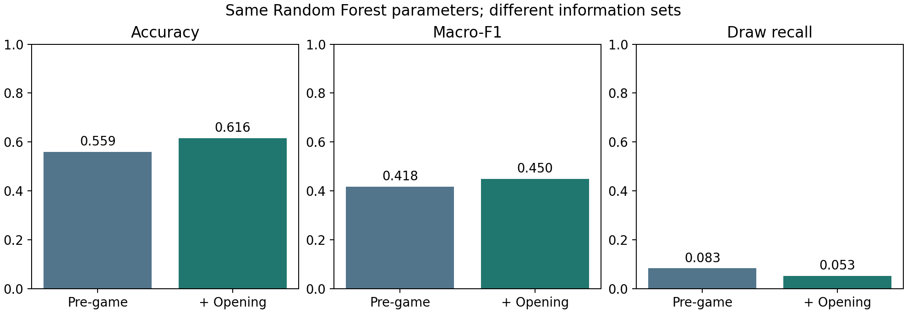

# Chess outcome prediction after 10 full moves

CA6001 group handover: **Random Forest after 10 full moves (20 plies)**.

使用双方各前10步结束时的信息，预测 **Black win / Draw / White win**。只使用随机森林，保留“赛前6列”与“赛前＋开局46列”的特征实验。**此仓库不包含Stockfish扩展或旧10半回合实验。**

## 先从这里开始

1. 阅读中文操作说明 [docs/HANDOVER_ZH.md](docs/HANDOVER_ZH.md)。
2. 在项目根目录打开 [Modelling_Evaluation.ipynb](Modelling_Evaluation.ipynb)，查看已执行的建模与评估结果。Run All只读取保存结果，不重新训练或评分测试集。
3. 阅读 [docs/MODELLING_EVALUATION.md](docs/MODELLING_EVALUATION.md)，了解冻结参数、结果和局限。

## 环境

推荐 **Python 3.12**（实际验证3.12.14；固定依赖要求Python >=3.11）。

```bash
git clone https://github.com/processor-zhong/Chess.git
cd Chess
python -m venv .venv
# macOS / Linux
source .venv/bin/activate
# Windows PowerShell: .venv\Scripts\Activate.ps1
python -m pip install -r requirements-notebook.txt
jupyter lab
```

只跑脚本可安装 `requirements.txt`。模型文件和数据都已包含，不需要重新下载数据或重新训练才能查看结果。

## 已有最终测试结果

同一批2,565场测试对局；两个信息集使用相同随机森林参数。

| 指标 | 赛前6列 | 赛前＋开局46列 |
|---|---:|---:|
| Accuracy | 55.95% | 61.64% |
| Macro-F1 | 0.4177 | 0.4495 |
| Balanced Accuracy | 41.92% | 45.02% |
| Draw recall | 8.33% | 5.30% |
| Log Loss，越低越好 | 0.9101 | 0.8836 |



整体预测改善，但132场和棋只识别7场，不能只看Accuracy。该时点实验是在更早一轮结果被查看后开展的探索；沿用的历史测试时间段不属于全新盲测。未进行显著性检验。

## 目录

```text
Modelling_Evaluation.ipynb        已执行结果查看入口
README.md
requirements*.txt
run_plan_a20.py                  生成20半回合输入
validate_plan_a20.py              数据/棋谱/接口检查
run_rf_modelling20.py             训练内CV、冻结、最终评估
rebuild_data.py                   从原始CSV完整重建（临时目录隔离旧格式）
predict_opening.py                用一场新的20半回合棋谱预测
verify_snapshot.py               核对共享文件哈希和保存的测试指标
src/                             清洗、棋局特征、模型与指标实现
data/raw/                        原始CSV、来源和许可说明
data/processed/                  去重后的完整审计表，不可整表喂给模型
data/splits/split_manifest.csv   原固定时间分区与边界排除
data/plan_a20/splits/             本版训练/验证 X、y、meta
data/plan_a20/holdout/            本版冻结测试 X、y、meta
tables/plan_a20/                 特征字典、排除日志、训练集统计
artifacts/plan_a20/              特征契约、来源哈希、88项检查结果
modelling_rf/run_20261025_20ply_01/
  models/                        两种信息集的训练模型和最终重训模型
  tables/                        CV、验证、测试、分类别指标及逐场预测
  figures/                       指标图、混淆矩阵、重要性图
  artifacts/                     流程、冻结配置和结果验证记录
docs/                            数据协议、操作和结果说明
```

## 复现与继续工作

```bash
python verify_snapshot.py
python validate_plan_a20.py
# 新实验使用独立目录；local_*默认不进入Git
python run_rf_modelling20.py --stage tune --output modelling_rf/local_my_experiment
# 只有方案冻结并且小组决定正式评估后，才执行：
python run_rf_modelling20.py --stage finalize --output modelling_rf/local_my_experiment
```

不要覆盖已有结果，不要根据测试成绩回头调参，不要将meta中的ID/FEN或完整审计表中的赛后字段输入模型。不要为了提高成绩删除和棋。更改特征需同步更新预处理和契约。

## 对新的开局预测

提供恰好20个半回合的合法SAN棋谱，例如：

```bash
python predict_opening.py --white-rating 1600 --black-rating 1500 --base-minutes 10 --increment-seconds 0 --moves "e4 e5 Nf3 Nc6 Bb5 a6 Ba4 Nf6 O-O Be7 Re1 b5 Bb3 d6 c3 O-O h3 Nb8 d4 Nbd7"
```

输出预测类别及三类概率，不会读取测试集。

## 数据来源

[Chess Game Dataset (Lichess), Mitchell J / datasnaek](https://www.kaggle.com/datasets/datasnaek/chess)，发布页标注CC0。
原始20,058行，清洗后19,111个对局ID。本版过滤后训练11,936、验证2,549、测试2,565场。详见 [数据协议](docs/DATA_PROTOCOL.md) 和 [原始来源](data/raw/SOURCE.md)。

仓库未替团队代码指定额外的开源许可；数据仍按其发布者标注的许可使用。此交接不包含课程正式报告。
